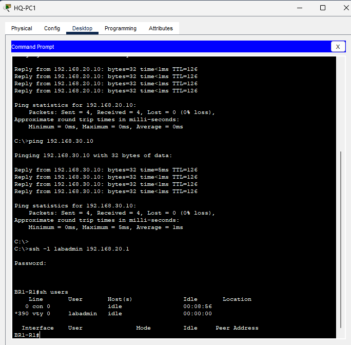
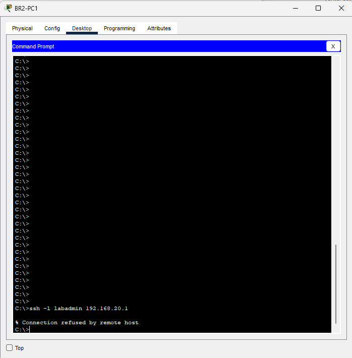
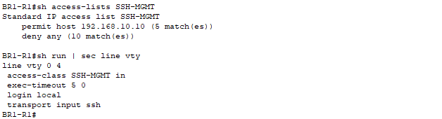
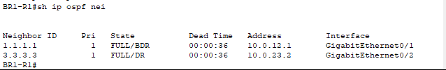

# Multisite Secure Router Management Lab

## Overview

I configured SSH version 2 on BR1-R1 in Cisco Packet Tracer, tested local authentication, and restricted remote logins to HQ-PC1 using a standard ACL on the VTY lines. I verified that HQ could log in, BR2 could not, Telnet provided no login session, and OSPF neighbors remained FULL.

This guided personal lab was completed by Michael Bessard to practice secure network administration.

## Environment

- Cisco Packet Tracer 8.2.2.
- Three-site network with HQ, BR1, and BR2.
- Multi-area OSPF and existing LAN traffic ACLs from my [service-filtering project](https://github.com/mikemsb81/multisite-acl-service-troubleshooting).
- Project: [multisite-secure-management.pkt](multisite-secure-management.pkt).

| Device | Address | Role |
| --- | --- | --- |
| HQ-PC1 | 192.168.10.10/24 | Authorized management source |
| BR1-R1 G0/0 | 192.168.20.1/24 | SSH destination used for testing |
| BR2-PC1 | 192.168.30.10/24 | Unauthorized management source |

## Management policy

| Connection | Intended result |
| --- | --- |
| SSH from HQ-PC1 to BR1 | Allow with valid local credentials |
| SSH from other sources to BR1 | Deny |
| Telnet to BR1 | No remote login |
| OSPF neighbor traffic | Continue operating |

The source restriction applies to VTY logins. It does not create a dedicated management network or filter transit traffic.

## SSH configuration

On BR1-R1, I configured the following through its direct CLI:

```text
configure terminal
ip domain-name lab.example
username labadmin privilege 15 secret LabSSH2026!
crypto key generate rsa
```

At the modulus prompt, I specified 2048 bits, then configured:

```text
ip ssh version 2
line vty 0 4
login local
transport input ssh
exec-timeout 5 0
end
show ip ssh
```

The username and password above are disposable simulator credentials, included for reproducing this lab only. They must not be reused on real systems.

- The domain name supports RSA key generation; no external domain registration was needed.
- The local account has privilege level 15, providing full administrative access.
- `login local` selects the router's local user database.
- `transport input ssh` selects SSH as the permitted remote-login transport.
- `exec-timeout 5 0` configures a five-minute idle session timeout.

The recorded status output confirmed **SSH Enabled - version 2.0**. The idle timeout was configured but not timed experimentally.

## Baseline login

From HQ-PC1, I connected using:

```text
ssh -l labadmin 192.168.20.1
```

After entering the lab password, the router prompt appeared. The `show users` output listed `labadmin` on VTY 0. I exited the session before applying the source restriction through the router's direct CLI.

## Restricting management sources

I inspected the VTY configuration, which showed lines 0–4, then applied:

```text
configure terminal
ip access-list standard SSH-MGMT
permit host 192.168.10.10
deny any
exit
line vty 0 4
access-class SSH-MGMT in
end
```

This standard ACL matches the connection's source IP. The `access-class` command applies it to VTY access, while the existing `ip access-group` on the LAN interface serves a separate transit-traffic filtering purpose.

The direct CLI remained available while changing remote access settings.

## Verification evidence

### Authorized SSH login

A fresh SSH connection from HQ-PC1 succeeded after the restriction was applied. One earlier attempt displayed “Login invalid”; a later attempt successfully authenticated.



### Unauthorized SSH connection

The same SSH command from BR2-PC1 returned **Connection refused by remote host**.



### Telnet test

From the authorized HQ PC, I tested:

```text
telnet 192.168.20.1
```

Packet Tracer briefly displayed “Open,” then closed the connection without presenting a login session. The recorded VTY configuration showed `transport input ssh`.


### ACL and VTY configuration

I checked:

```text
show access-lists SSH-MGMT
show running-config | section line vty
```

The recorded ACL showed five permit matches and ten deny matches. These are cumulative matches, not counts of successful or failed logins.

The VTY output confirmed:

```text
line vty 0 4
 access-class SSH-MGMT in
 exec-timeout 5 0
 login local
 transport input ssh
```



### Routing health

The final `show ip ospf neighbor` check showed:

| Neighbor router ID | Address | Interface | State |
| --- | --- | --- | --- |
| 1.1.1.1 (HQ) | 10.0.12.1 | G0/1 | FULL |
| 3.3.3.3 (BR2) | 10.0.23.2 | G0/2 | FULL |



This confirms neighbor health at verification time; it is not a continuous availability measurement.

## Repeating the tests

1. Open the saved project.
2. From HQ-PC1, run `ssh -l labadmin 192.168.20.1`, authenticate, then use `show users` and `exit`.
3. From BR2-PC1, repeat the SSH command and confirm access is refused.
4. From HQ-PC1, run `telnet 192.168.20.1` and confirm no login session is available.
5. Through BR1's direct CLI, inspect SSH status, the management ACL, VTY settings, and OSPF neighbors.

The uploaded configuration uses simulator-generated RSA keys. If the project opens without usable SSH keys in another environment, regenerate them through the direct CLI before testing.

## Saving and recovery

I saved BR1's configuration with:

```text
copy running-config startup-config
```

I also saved the Packet Tracer project.

If a management ACL mistake prevents remote login, use the direct CLI to correct the permitted source. To temporarily remove the VTY source restriction while retaining SSH-only transport:

```text
configure terminal
line vty 0 4
no access-class SSH-MGMT in
end
```

This recovery procedure is provided for repeatability; a management lockout was not deliberately performed in this lab.

## Scope and lessons

This project demonstrates SSHv2, local password authentication, source-based VTY restrictions, and verification of permitted and denied access. BR1-PC1 login denial, management access during WAN failover, idle-session expiry, and cryptographic negotiation details were not separately tested.

It does not implement centralized AAA, MFA, a dedicated out-of-band management network, or a complete production hardening standard. A permitted source address still needs valid credentials.

I learned to distinguish authentication failures from source-access restrictions, verify fresh sessions after management changes, and preserve direct CLI access while configuring remote administration.

